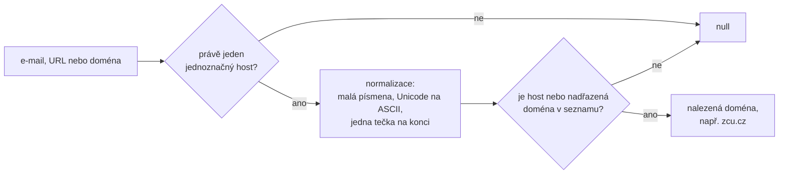

<p align="center">
  <picture>
    <source media="(prefers-color-scheme: dark)" srcset="https://raw.githubusercontent.com/danielsebesta/czsk-schools-domains/main/.github/assets/banner-cs-dark.svg">
    
  </picture>
</p>

<p align="center">
  <a href="https://www.npmjs.com/package/czsk-schools-domains"></a>
  <a href="https://github.com/danielsebesta/czsk-schools-domains/actions/workflows/pr-check.yml"></a>
  
  
  
  <a href="https://github.com/danielsebesta/czsk-schools-domains/blob/main/LICENSE"></a>
  <a href="https://github.com/danielsebesta/czsk-schools-domains/blob/main/LICENSE-DATA.txt"></a>
</p>

<p align="center">
  <a href="https://github.com/danielsebesta/czsk-schools-domains/blob/main/README.md">English</a> · <b>Čeština</b>
</p>

Zjistěte, jestli e-mailová adresa, URL nebo doména patří české nebo slovenské škole, od základních škol po univerzity. Ve slevovém seznamu je **7 330** škol, celkem **9 584** domén a každá je ověřená proti rejstříku nebo vlastnímu webu školy a proti DNS.

Data jsou metadata institucí z veřejných rejstříků: žádné e-mailové adresy, telefonní čísla ani kontaktní osoby. Kde oficiální název soukromé školy obsahuje jméno žijícího zřizovatele nebo ředitele, je použit neutrální název (typ školy a obec).

<p align="center">
  <a href="#rychlý-start">Rychlý start</a> ·
  <a href="#co-projde-a-co-ne">Co projde</a> ·
  <a href="#shoda-není-důkaz-že-jde-o-studenta">Bezpečnost</a> ·
  <a href="#co-je-v-datech">Data</a> ·
  <a href="#stejná-pravidla-v-pěti-jazycích">Další jazyky</a> ·
  <a href="#testy">Testy</a> ·
  <a href="#jak-přispět">Jak přispět</a>
</p>

## Rychlý start

```bash
npm install czsk-schools-domains
```

```ts
import { isSchoolDomain, matchSchoolDomain, extractDomain } from "czsk-schools-domains";

isSchoolDomain("student@student.zcu.cz");       // true  (shoda se zcu.cz)
isSchoolDomain("someone@gmail.com");            // false (freemail)
matchSchoolDomain("https://www.zcu.cz/studium"); // "zcu.cz"
extractDomain("Student <student@ZCU.cz>");      // "zcu.cz"
```

Bez závislostí, ESM i CommonJS, typy pro TypeScript, Node.js 18 a novější. Vstupem může být e-mailová adresa (i `Jméno <user@skola.cz>` a `mailto:`), URL nebo samotná doména.

| Export | Vrací |
|---|---|
| `isSchoolDomain(input)` | `true`, když je host nebo některá jeho nadřazená doména ve slevovém seznamu |
| `matchSchoolDomain(input)` | nalezenou položku seznamu (`"zcu.cz"`), nebo `null` |
| `extractDomain(input)` | normalizovaný host (`"www.zcu.cz"`), nebo `null`, když je vstup nejednoznačný |
| `createChecker(list)` | `{ isSchool, match, size }` pro jakýkoli jiný seznam |
| `schoolDomains` | slevový seznam: zmrazený a seřazený |

<details>
<summary><b>Další příklady</b></summary>

```ts
import { readFileSync } from "node:fs";
import { isSchoolDomain, matchSchoolDomain, createChecker } from "czsk-schools-domains";

// Na velikosti písmen nezáleží; shodují se i subdomény domén ze seznamu
isSchoolDomain("student@gapps.zcu.cz");         // true  (shoda se zcu.cz)
isSchoolDomain("123456@mail.muni.cz");          // true  (shoda s muni.cz)
isSchoolDomain("student@fiit.stuba.sk");        // true  (shoda s fiit.stuba.sk)
isSchoolDomain("student@st.uniba.sk");          // true  (shoda s uniba.sk)
isSchoolDomain("zak@student.gjp.cz");           // true  (shoda se student.gjp.cz)
isSchoolDomain("info@skola.hradekususice.cz");  // true  (shoda se skola.hradekususice.cz)

// Nejsou školy
isSchoolDomain("someone@seznam.cz");            // false (freemail)
isSchoolDomain("info@hradekususice.cz");        // false (portál obce; v seznamu je jen skola.*)
isSchoolDomain("info@18mskladno.cz");           // false (mateřská škola; jen v domains-all.json)
isSchoolDomain("x@neoverena-skola.edu.cz");     // false (neověřená subdoména edu.cz)
isSchoolDomain("x@neoverena-skola.edu.sk");     // false (neověřená subdoména edu.sk)

// Nejednoznačný vstup je odmítnut
matchSchoolDomain("https://evil.example/?a=x@zcu.cz"); // null („@“ v cestě nebo dotazu není host)
matchSchoolDomain("zcu.cz/@evil.example");      // null (pošta by šla na evil.example)
matchSchoolDomain("a@evil.example, b@zcu.cz");  // null (více příjemců)

// Jakýkoli jiný seznam, např. domains-all.json (s mateřskými školami) z GitHub Release.
// createChecker vyhodí TypeError u položek, které nejsou platná doménová jména.
const all = createChecker(JSON.parse(readFileSync("domains-all.json", "utf8")));
all.isSchool("info@18mskladno.cz");             // true
```

</details>

## Co projde a co ne



| Vstup | Host | Shoda | Výsledek |
|---|---|---|---|
| `student@zcu.cz` | `zcu.cz` | `zcu.cz` | **škola** |
| `Student <student@ZCU.cz>` | `zcu.cz` | `zcu.cz` | **škola**: na zobrazovaném jméně a velikosti písmen nezáleží |
| `https://www.zcu.cz/studium` | `www.zcu.cz` | `zcu.cz` | **škola**: subdoména se shoduje se svou nadřazenou doménou ze seznamu |
| `ｓtudent@ｚcu.cz`, `x@zcu。cz` | `zcu.cz` | `zcu.cz` | **škola**: plnošířková písmena a tečky se normalizují |
| `someone@seznam.cz` | `seznam.cz` | `null` | není škola: freemail |
| `info@18mskladno.cz` | `18mskladno.cz` | `null` | není škola: mateřská škola, jen v `domains-all.json` |
| `x@škola.cz` | `xn--kola-f6a.cz` | `null` | není škola: žádná doména v seznamu nemá diakritiku |
| `https://evil.example/?a=x@zcu.cz` | `evil.example` | `null` | není škola: host je `evil.example` |
| `zcu.cz/@evil.example` | `null` | `null` | odmítnuto: pošta by šla na `evil.example` |
| `a@evil.example, b@zcu.cz` | `null` | `null` | odmítnuto: více příjemců |
| `a@evil.example@zcu.cz` | `null` | `null` | odmítnuto: víc než jeden `@` |
| `@relay.example:x@zcu.cz` | `null` | `null` | odmítnuto: source route (směrování přes jiný server) |
| `x@zcu\u200b.cz` | `null` | `null` | odmítnuto: neviditelný znak (mezera nulové šířky) |
| `x@192.168.0.1` | `null` | `null` | odmítnuto: IP adresa není doména |
| `student'--@zcu.cz` | `zcu.cz` | `zcu.cz` | **škola**, ale kontroluje se jen doména: vstup escapujte |
| `javascript://zcu.cz/%0aalert(1)` | `zcu.cz` | `zcu.cz` | **škola**, ale shoda neznamená bezpečný odkaz |

## Shoda není důkaz, že jde o studenta

> [!IMPORTANT]
> Shoda říká jen to, že adresa vede na doménu školy. **Ověřte schránku**: pošlete na přesně tuto adresu jednorázový kód a nechte si ho vrátit. Kde to jde, chtějte i kartu ISIC nebo potvrzení o studiu.

- Adresy na školních doménách mají i učitelé, další zaměstnanci, na některých školách rodiče a někdy i absolventi (např. `alumni.cvut.cz`). Shodují se i subdomény domén ze seznamu, např. univerzitní mateřská škola pod doménou univerzity.
- Nejdřív ověřte formát adresy. Balíček odmítá nejednoznačný vstup: více příjemců, komentáře, část před `@` v uvozovkách, zpětná lomítka, víc než jeden `@`, `:` v adrese (source route jako `@relay.example:student@school.cz`), `@` spolu s `/`, `?` nebo `#` (`school.cz/@evil.example` je adresa na `evil.example`) a neviditelné nebo obousměrné formátovací znaky (mezera nulové šířky, right-to-left override).
- Kontroluje se jen doména. Část před `@` projde tak, jak byla napsaná, takže vstup před použitím v SQL, HTML, hlavičkách e-mailu nebo příkazu shellu escapujte nebo parametrizujte. Ani shodující se URL není bezpečný odkaz.
- Většina žáků základních škol je pod věkovou hranicí pro digitální souhlas podle GDPR (15 let v Česku, 16 na Slovensku). Pokud se spoléháte na souhlas, žádejte souhlas rodičů, nebo pomocí `level` v `domains-detailed.json` základní školy vynechte.
- Domény mění majitele. Seznam se znovu kontroluje, ale doména, která včera vypršela, v něm ještě může být: krok s jednorázovým kódem si nechte.

## Když škola chybí

Chybějící školu může kdokoli navrhnout přes formulář [Add a school](https://github.com/danielsebesta/czsk-schools-domains/issues/new?template=add-school.yml), bez úprav souborů. Správce doménu před přidáním ověří podle webu školy nebo rejstříku.

Služba se studentskou slevou může na formulář odkázat, když adresa neprojde. Parametr `domain` doménu do formuláře rovnou vyplní:

```ts
import { isSchoolDomain, extractDomain } from "czsk-schools-domains";

const domain = extractDomain(email);
if (domain && !isSchoolDomain(email)) {
  const url = new URL("https://github.com/danielsebesta/czsk-schools-domains/issues/new");
  url.searchParams.set("template", "add-school.yml");
  url.searchParams.set("title", `Add school: ${domain}`);
  url.searchParams.set("domain", domain);
  // zobrazte „Chybí vaše škola? Navrhněte ji“ s odkazem na url.href
}
```

- Formulář vyžaduje účet na GitHubu.
- Schválená doména je v seznamech na `main` hned po kontrole a v npm balíčku od dalšího vydání.
- Freemailové adresy (`gmail.com`, `seznam.cz`, …) se nepřidávají nikdy, takže u nich odkaz nezobrazujte.

## Co je v datech

| Soubor | Obsah | Domén |
|---|---|---:|
| [`domains.json`](https://github.com/danielsebesta/czsk-schools-domains/blob/main/data/domains.json), [`domains.txt`](https://github.com/danielsebesta/czsk-schools-domains/blob/main/data/domains.txt) | Slevový seznam: školy od základních po vysoké, umělecké a jazykové školy, střediska volného času | 7 330 |
| [`domains-all.json`](https://github.com/danielsebesta/czsk-schools-domains/blob/main/data/domains-all.json) | Slevový seznam a navíc mateřské školy, jesle, školská zařízení a univerzitní pracoviště jen pro zaměstnance | 9 584 |
| [`domains-detailed.json`](https://github.com/danielsebesta/czsk-schools-domains/blob/main/data/domains-detailed.json) | Každá doména s názvem školy, adresou, IČO, typem a údaji z DNS | 9 584 |
| [`custom-domains.json`](https://github.com/danielsebesta/czsk-schools-domains/blob/main/data/custom-domains.json) | Příspěvky komunity | |
| [`blocklist.json`](https://github.com/danielsebesta/czsk-schools-domains/blob/main/data/blocklist.json) | Domény, které v seznamu nesmí být nikdy: freemaily, poskytovatelé připojení, hostingy, obce | 267 |

Všechny čtyři seznamy jsou přiložené i ke každému [GitHub Release](https://github.com/danielsebesta/czsk-schools-domains/releases). Školská zařízení jsou jídelny, internáty a domovy mládeže, poradny, dětské domovy a výchovné ústavy; pracoviště jen pro zaměstnance jsou rektoráty a výzkumná centra.

<p align="center">
  <picture>
    <source media="(prefers-color-scheme: dark)" srcset="https://raw.githubusercontent.com/danielsebesta/czsk-schools-domains/main/.github/assets/chart-types-cs-dark.svg">
    
  </picture>
</p>

| Typ školy | `kind` | CZ | SK | Celkem |
|---|---|---:|---:|---:|
| Základní školy (ZŠ) | `zs` | 3 521 | 618 | 4 139 |
| Střední školy (SŠ, SOŠ, SOU) | `sos` | 727 | 272 | 999 |
| Základní umělecké školy (ZUŠ) | `zus` | 430 | 163 | 593 |
| Gymnázia | `gymnazium` | 389 | 165 | 554 |
| Speciální školy | `special` | 269 | 74 | 343 |
| Střediska volného času (DDM, SVČ, CVČ) | `ddm` | 214 | 47 | 261 |
| Vyšší odborné školy (VOŠ) | `vos` | 167 | 0 | 167 |
| Vysoké školy | `vs` | 78 | 42 | 120 |
| Fakulty | `fakulta` | 57 | 42 | 99 |
| Jazykové školy | `jazykova` | 17 | 11 | 28 |
| Konzervatoře | `konzervator` | 19 | 8 | 27 |
| **Slevový seznam** | | **5 888** | **1 442** | **7 330** |

E-maily přijímá 6 892 ze 7 330 domén (94 %). Ostatní jsou weby škol bez vlastní pošty; v seznamu zůstávají, aby se shodovaly URL.

### Formát záznamu

Každý záznam v `domains-detailed.json` vypadá takto:

```json
{
  "domain": "zcu.cz",
  "name": "Západočeská univerzita v Plzni",
  "address": "Univerzitní 2732/8",
  "city": "Plzeň",
  "zip": "30100",
  "ico": "49777513",
  "id": null,
  "country": "CZ",
  "kind": "vs",
  "level": "he",
  "confidence": 100,
  "verified": true,
  "in_discount": true,
  "mx": true,
  "sources": ["hipo-university-domains", "jetbrains-swot", "school-email-own-domain", "school-website", "wikidata-website"]
}
```

| Pole | Formát |
|---|---|
| `name` | Oficiální název ze školského rejstříku (CZ RSSZ, SK RIS), jinak název z ARES / RPO. Právní formy se píšou jednotně (`, s.r.o.`, `, spol. s r.o.`, `, o.p.s.`, `, z.ú.`, `, a.s.`, `, n.o.`, `, příspěvková organizace`); pomlčka s mezerami je vždy ` - `. |
| `address` | `Ulice 123/4` (číslo popisné / orientační), `Ulice 4`, když je jen jedno číslo, nebo část obce, když ulice chybí (`Hrhov 46`). |
| `city` | Obec tak, jak ji píše rejstřík (`Praha`, `Frýdek-Místek`). Městské části Bratislavy a Košic se píšou jako `Bratislava` / `Košice`. |
| `zip` | PSČ: 5 číslic bez mezery (`11000`). |
| `ico` | Osmimístné IČO. `null` u slovenských škol bez vlastního IČO (např. mateřské školy zřizované přímo obcí) a u několika institucí bez potvrzeného IČO. |
| `id` | CZ `RED_IZO` nebo SK `EDUID`. |
| `country` | `CZ` nebo `SK`. |
| `kind`, `level` | Typ školy (tabulka výše, v `domains-all.json` navíc `ms`, `jesle`, `other_edu`) a stupeň: `primary`, `secondary`, `he`, `preschool` nebo `other`. |
| `confidence` | 0–100: jak jistá je klasifikace školy. |
| `verified` | `true`, když správci doménu ověřili proti rejstříku nebo vlastnímu webu či e-mailovému kontaktu školy. Nový příspěvek komunity začíná jako `false` s `confidence` 50. |
| `in_discount` | `true`, když je doména ve slevovém seznamu. |
| `mx` | `true`, když měla doména při kontrole DNS 25. 11. 2026 záznam MX s dohledatelným poštovním serverem. `false`: žádný záznam MX, nulový MX (`0 .`) nebo MX mířící na neexistující server. Kde rejstřík uvádí pro školu jinou e-mailovou doménu, je v seznamu i ta. |
| `sources` | Kde byla doména nalezena a potvrzena. |

- Adresy pocházejí z českého školského rejstříku podle `RED_IZO`, potom ze sídla v ARES podle IČO; na Slovensku ze školského rejstříku podle `EDUID` / IČO, potom ze sídla v RPO. Fakulty a další součásti univerzity mají IČO a adresu sídla univerzity.
- `address`, `city` a `zip` jsou `null` u 12 záznamů bez potvrzeného záznamu v rejstříku. U 3 škol vedených fyzickou osobou je uvedena jen obec (`city`).
- `domains-detailed.json` je kurátorovaný: vznikl z rejstříků pomocí neveřejných nástrojů a ruční kontroly a z tohoto repozitáře ho znovu vygenerovat nelze. Změny jdou přes `custom-domains.json` / `blocklist.json`, nebo přes PR se změnou záznamu, který projde kontrolou.

## Stejná pravidla v pěti jazycích

| Jazyk | Kód | Domény s diakritikou | Dávkový režim |
|---|---|---|---|
| TypeScript / JavaScript | [balíček na npm](https://www.npmjs.com/package/czsk-schools-domains) | ano | |
| Python | [`examples/python`](https://github.com/danielsebesta/czsk-schools-domains/blob/main/examples/python/check.py) | ano | `--json` |
| PHP | [`examples/php`](https://github.com/danielsebesta/czsk-schools-domains/blob/main/examples/php/check.php) | s `ext-intl` | `--json` |
| Go | [`examples/go`](https://github.com/danielsebesta/czsk-schools-domains/tree/main/examples/go) | jen ASCII | `-json` |
| Shell | [`examples/shell`](https://github.com/danielsebesta/czsk-schools-domains/blob/main/examples/shell/check.sh) | ne: jen prosté adresy, přesná shoda | |

```bash
python examples/python/check.py student@zcu.cz
php examples/php/check.php student@zcu.cz
bash examples/shell/check.sh student@zcu.cz
cd examples/go && go run . student@zcu.cz
```

Ukázky dodržují stejná pravidla pro vstup jako balíček. Dávkový režim čte ze standardního vstupu pole vstupů v JSON a vypisuje pole `[host, shoda]`; testy přes něj porovnávají každou odpověď s balíčkem.

## Testy

| Sada | Co kontroluje |
|---|---|
| Korpus | Přes 300 vstupů, které lidé píšou nebo zkoušejí útočníci, v 11 skupinách: překlepy, mezery z kopírování, Unicode a plnošířkové znaky, homoglyfy, IP adresy, neviditelné a bidi znaky, injection do SQL / HTML / hlaviček / shellu, pokusy o obejití |
| Fuzzing | 30 000 generovaných vstupů porovnaných s parserem URL podle WHATWG a s orákulem pro e-mailové adresy |
| Míchání | Doména ze seznamu smíchaná s doménou útočníka a oddělovači projde jen tehdy, když pošta opravdu půjde do školy |
| ReDoS | 2 KB škodlivé vstupy doběhnou v milisekundách |
| Mezi jazyky | Stejné vstupy a dalších 6 000 generovaných projdou ukázkami v Pythonu, PHP, Go a shellu; každá odpověď musí sedět s balíčkem |
| API | Hodnoty, které nejsou řetězce, odpojené funkce, okrajové případy `createChecker` |
| Data | Zveřejněný seznam je seřazený, normalizovaný a bez blokovaných domén, freemailů a veřejných e-mailových služeb |
| README | Spouští se každý příklad z tohoto README i z anglického |

Spusťte `npm test` ve složce `packages/ts` (Node.js 22.18 nebo novější). Chybějící runtime se přeskočí, pokud není nastaveno `REQUIRE_EXAMPLE_RUNTIMES=1` (jako v CI).

## Automatizace

| Workflow | Kdy | Co dělá |
|---|---|---|
| [Kontrola PR](https://github.com/danielsebesta/czsk-schools-domains/blob/main/.github/workflows/pr-check.yml) | pull requesty, push do `main` | Ověří data skripty z cílové větve, takže PR nemůže oslabit vlastní kontroly. Druhý job sestaví balíček a spustí všechny testy. |
| [Audit DNS](https://github.com/danielsebesta/czsk-schools-domains/blob/main/.github/workflows/dns-audit.yml) | jednou měsíčně | Založí nebo aktualizuje issue se seznamem domén bez aktivních záznamů DNS nebo MX. |
| [Release](https://github.com/danielsebesta/czsk-schools-domains/blob/main/.github/workflows/release.yml) | tagy `vX.Y.Z` | Po schválení správcem publikuje balíček na npm s provenance a přiloží seznamy ke GitHub Release. |

Co přesně kontrola PR ověřuje, popisuje [CONTRIBUTING.md](https://github.com/danielsebesta/czsk-schools-domains/blob/main/CONTRIBUTING.md#what-the-pr-check-verifies) (anglicky).

## Jak přispět

Chybí škola? Vyplňte formulář [Add a school](https://github.com/danielsebesta/czsk-schools-domains/issues/new?template=add-school.yml). Doména nefunguje nebo nesedí údaje? Návod je v [CONTRIBUTING.md](https://github.com/danielsebesta/czsk-schools-domains/blob/main/CONTRIBUTING.md) (anglicky). Odebrání položky z blocklistu, změnu `kind` u záznamu, přesun záznamu do slevového seznamu nebo přidání víc než 200 domén musí zkontrolovat správce.

## Opravy a ochrana osobních údajů

- Škola může požádat o opravu nebo odstranění své domény přes formulář [Correction or removal](https://github.com/danielsebesta/czsk-schools-domains/issues/new?template=correction.yml). Do issues prosím nepište osobní údaje. Žádosti vyřizujeme do jednoho měsíce.
- Zveřejňujeme domény škol a vlastní metadata institucí z veřejných rejstříků (název, adresa sídla, IČO, identifikátor z rejstříku, typ školy) a technické údaje z DNS. Žádné e-mailové adresy, telefonní čísla ani jména kontaktních osob.
- Účel a právní základ: pomoc službám rozpoznat školní e-mailové domény (oprávněný zájem, čl. 6 odst. 1 písm. f) GDPR). Kde se záznam týká fyzické osoby (škola vedená podnikající fyzickou osobou), je uvedena jen obec; přes stejný formulář můžete vznést námitku nebo požádat o opravu či odstranění.

## Zdroje a licence

| Zdroj | K čemu | Licence |
|---|---|---|
| Český školský rejstřík (adresář RSSZ) | školy, oficiální názvy, adresy, `RED_IZO` | veřejný rejstřík |
| Slovenský školský rejstřík (RIS, eduZoznam) | školy, oficiální názvy, adresy, `EDUID` | veřejný rejstřík |
| ARES (CZ), RPO (SK) | názvy právnických osob a sídla podle IČO | veřejné rejstříky |
| Registry vysokých škol MŠMT (CZ) | vysoké školy | veřejný rejstřík |
| Weby škol a jejich kontaktní stránky | domény a jejich potvrzení | |
| [Wikidata](https://www.wikidata.org/) | weby škol | CC0 |
| [JetBrains/swot](https://github.com/JetBrains/swot) | akademické domény | MIT |
| [Hipo/university-domains-list](https://github.com/Hipo/university-domains-list) | domény univerzit | MIT |

RPO od června 2026 spravuje Ministerstvo vnitra Slovenské republiky, předtím Štatistický úrad SR. Jazykové modely pomáhaly určit typ školy z úvodních stránek webů; sporné případy se rozhodly podle rejstříků nebo ručně.

- **Data** (`data/` a seznam v balíčku na npm): [CC BY 4.0](https://github.com/danielsebesta/czsk-schools-domains/blob/main/LICENSE-DATA.txt). Uvedení zdrojů a licenční texty třetích stran jsou v [THIRD_PARTY_NOTICES.md](https://github.com/danielsebesta/czsk-schools-domains/blob/main/THIRD_PARTY_NOTICES.md).
- **Kód** (skripty, ukázky, `packages/ts`): [MIT](https://github.com/danielsebesta/czsk-schools-domains/blob/main/LICENSE).
