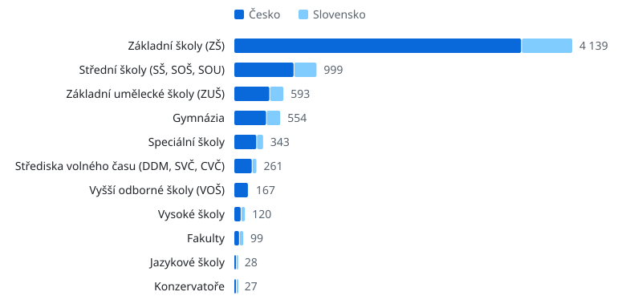

<p align="center">
  
</p>

<h1 align="center">Domény českých a slovenských škol</h1>

<p align="center">
  <a href="https://www.npmjs.com/package/czsk-schools-domains"></a>
</p>

<p align="center">
  <a href="https://github.com/danielsebesta/czsk-schools-domains/blob/main/README.md">English</a> · <b>Čeština</b>
</p>

Zjistěte, jestli e-mailová adresa, URL nebo doména patří české nebo slovenské škole, od základních škol po univerzity. Pro služby, které dávají studentům slevu.

## V číslech

Ve slevovém seznamu je **7 330** škol, 5 888 v Česku a 1 442 na Slovensku. S mateřskými školami, jeslemi a školskými zařízeními je to celkem **9 584** domén.

<p align="center">
  <picture>
    <source media="(prefers-color-scheme: dark)" srcset="https://raw.githubusercontent.com/danielsebesta/czsk-schools-domains/main/.github/assets/chart-types-cs-dark.svg">
    
  </picture>
</p>

## Jak spolehlivá data jsou

- Každá doména je ověřená proti školskému rejstříku nebo vlastnímu webu školy. 97 % škol ze slevového seznamu je propojených se svým záznamem v českém nebo slovenském školském rejstříku.
- 94 % z nich přijímá e-maily. Zbytek jsou weby škol bez vlastní pošty; v seznamu zůstávají, aby se shodovaly i webové adresy.
- Freemaily, poskytovatelé připojení, webhostingy a obecní domény v seznamu nejsou nikdy.
- DNS se kontroluje každý měsíc a nefunkční domény se odstraňují.

## Odkud data jsou

Z českého a slovenského školského rejstříku, z rejstříků právnických osob ARES (CZ) a RPO (SK), z registru vysokých škol MŠMT, z webů samotných škol, z Wikidat, z [JetBrains/swot](https://github.com/JetBrains/swot) a z [Hipo/university-domains-list](https://github.com/Hipo/university-domains-list). Typ školy pomáhaly určit jazykové modely; sporné případy se rozhodly podle rejstříků nebo ručně.

## Jak to použít

**Bez programování** si stáhněte seznam z [posledního vydání](https://github.com/danielsebesta/czsk-schools-domains/releases/latest):

| Soubor | Obsah |
|---|---|
| `domains.txt`, `domains.json` | slevový seznam |
| `domains-all.json` | slevový seznam a navíc mateřské školy, jesle a školská zařízení |
| `domains-detailed.json` | každá doména s názvem školy, adresou, IČO a typem |

**V JavaScriptu nebo TypeScriptu:**

```bash
npm install czsk-schools-domains
```

```ts
import { isSchoolDomain, matchSchoolDomain } from "czsk-schools-domains";

isSchoolDomain("student@student.zcu.cz");        // true
isSchoolDomain("someone@gmail.com");             // false
matchSchoolDomain("https://www.zcu.cz/studium"); // "zcu.cz"
```

Přijme e-mailovou adresu, URL nebo samotnou doménu a cokoli nejednoznačného odmítne. Bez závislostí, s typy, Node.js 18 a novější. Další exporty a přesná pravidla jsou v [AGENTS.md](https://github.com/danielsebesta/czsk-schools-domains/blob/main/AGENTS.md#matching-rules) (anglicky).

**V Pythonu, PHP, Go nebo shellu** si zkopírujte kontrolu v jednom souboru ze složky [`examples/`](https://github.com/danielsebesta/czsk-schools-domains/tree/main/examples).

> [!IMPORTANT]
> Shoda znamená, že adresa patří škole, ne že její majitel je student: školní adresy mají i učitelé a absolventi. Než slevu dáte, pošlete na adresu jednorázový kód.

## Jak uvést zdroj

Data jsou pod licencí [CC BY 4.0](https://github.com/danielsebesta/czsk-schools-domains/blob/main/LICENSE-DATA.txt), kód pod [MIT](https://github.com/danielsebesta/czsk-schools-domains/blob/main/LICENSE). Když seznamy zveřejníte nebo je dodáváte v aplikaci či ve front-endovém bundlu, uveďte tento řádek, třeba na stránce O aplikaci nebo v licencích:

```text
Domény škol: přispěvatelé czsk-schools-domains, CC BY 4.0, https://github.com/danielsebesta/czsk-schools-domains
```

S daty ponechte i [THIRD_PARTY_NOTICES.md](https://github.com/danielsebesta/czsk-schools-domains/blob/main/THIRD_PARTY_NOTICES.md); balíček na npm ho už obsahuje. Když adresy kontrolujete jen na vlastním serveru, data nesdílíte, takže uvedení zdroje je tam dobrovolné.

## Chybí škola nebo nesedí údaje

- **Chybí škola:** vyplňte formulář [Add a school](https://github.com/danielsebesta/czsk-schools-domains/issues/new?template=add-school.yml). Vaše služba na něj může odkázat s už vyplněnou doménou: `https://github.com/danielsebesta/czsk-schools-domains/issues/new?template=add-school.yml&domain=zs-example.cz`
- **Špatné údaje nebo odstranění:** použijte formulář [Correction or removal](https://github.com/danielsebesta/czsk-schools-domains/issues/new?template=correction.yml). Žádosti vyřizujeme do jednoho měsíce.
- **Pull requesty:** pravidla a kontroly jsou v [AGENTS.md](https://github.com/danielsebesta/czsk-schools-domains/blob/main/AGENTS.md) (anglicky).

## Ochrana osobních údajů

Seznamy obsahují jen údaje o institucích z veřejných rejstříků: žádné e-mailové adresy, telefonní čísla ani kontaktní osoby. U školy vedené fyzickou osobou je uvedena jen obec a soukromá škola pojmenovaná po žijícím zřizovateli nebo řediteli má neutrální název. Účelem je pomoci službám rozpoznat školní e-mailové domény (oprávněný zájem, čl. 6 odst. 1 písm. f) GDPR). Námitku můžete vznést přes formulář pro opravy.
