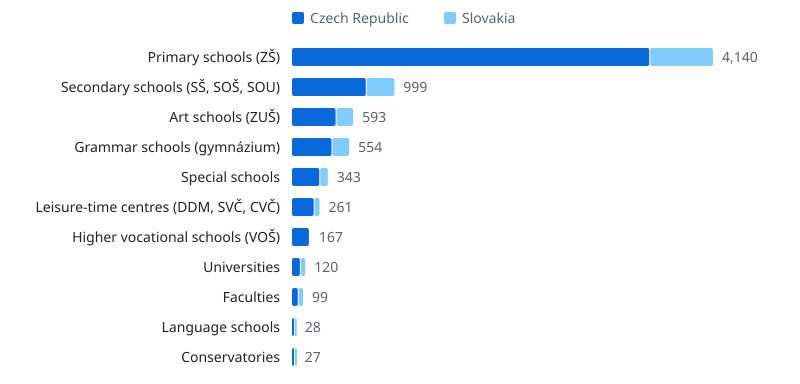

<p align="center">
  
</p>

<h1 align="center">Czech &amp; Slovak School Domains</h1>

<p align="center">
  <a href="https://www.npmjs.com/package/czsk-schools-domains"></a>
</p>

<p align="center">
  <b>English</b> · <a href="https://github.com/danielsebesta/czsk-schools-domains/blob/main/README.cs.md">Čeština</a>
</p>

Check whether an e-mail address, URL or domain belongs to a Czech or Slovak school, from primary schools to universities. Made for services that give students a discount.

## In numbers

**7,330** schools are in the discount list, 5,888 in the Czech Republic and 1,442 in Slovakia. With kindergartens, nurseries and school facilities, there are **9,584** domains in total.

<p align="center">
  <picture>
    <source media="(prefers-color-scheme: dark)" srcset="https://raw.githubusercontent.com/danielsebesta/czsk-schools-domains/main/.github/assets/chart-types-en-dark.svg">
    
  </picture>
</p>

## How reliable it is

- Every domain was confirmed against a school register or the school's own website. 97 % of the schools in the discount list are linked to their record in the Czech or Slovak school register.
- 94 % of them receive e-mail. The rest are school websites without their own mail, kept so that web addresses match too.
- Free-mail, internet provider, web hosting and municipal domains are never listed.
- DNS is re-checked every month, and dead domains are removed.

## Where the data comes from

The Czech and Slovak school registers, the ARES (CZ) and RPO (SK) registers of legal entities, the MŠMT register of universities, the schools' own websites, Wikidata, [JetBrains/swot](https://github.com/JetBrains/swot) and [Hipo/university-domains-list](https://github.com/Hipo/university-domains-list). Language models helped to sort schools by type; disputed cases were settled by the registers or by hand.

## How to use it

**Without code**, download a list from the [latest release](https://github.com/danielsebesta/czsk-schools-domains/releases/latest):

| File | Contents |
|---|---|
| `domains.txt`, `domains.json` | the discount list |
| `domains-all.json` | the discount list plus kindergartens, nurseries and school facilities |
| `domains-detailed.json` | every domain with the school's name, address, IČO and type |

**In JavaScript or TypeScript:**

```bash
npm install czsk-schools-domains
```

```ts
import { isSchoolDomain, matchSchoolDomain } from "czsk-schools-domains";

isSchoolDomain("student@student.zcu.cz");        // true
isSchoolDomain("someone@gmail.com");             // false
matchSchoolDomain("https://www.zcu.cz/studium"); // "zcu.cz"
```

It takes an e-mail address, a URL or a bare domain, and refuses anything ambiguous. No dependencies, types included, Node.js 18 or newer. The other exports and the exact rules are in [AGENTS.md](https://github.com/danielsebesta/czsk-schools-domains/blob/main/AGENTS.md#matching-rules).

**In Python, PHP, Go or shell**, copy a single-file checker from [`examples/`](https://github.com/danielsebesta/czsk-schools-domains/tree/main/examples).

> [!IMPORTANT]
> A match means the address belongs to a school, not that its owner is a student: teachers and graduates have school addresses too. Send a one-time code to the address before you grant a discount.

## How to credit it

The data is under [CC BY 4.0](https://github.com/danielsebesta/czsk-schools-domains/blob/main/LICENSE-DATA.txt), the code under [MIT](https://github.com/danielsebesta/czsk-schools-domains/blob/main/LICENSE). If you publish the lists or ship them in an app or a front-end bundle, add this line, for example to your about or licences page:

```text
School domains: czsk-schools-domains contributors, CC BY 4.0, https://github.com/danielsebesta/czsk-schools-domains
```

Keep [THIRD_PARTY_NOTICES.md](https://github.com/danielsebesta/czsk-schools-domains/blob/main/THIRD_PARTY_NOTICES.md) with the data as well; the npm package already contains it. Checking addresses only on your own server does not share the data, so there the credit is optional.

## Missing school or wrong data

- **Missing school:** fill in the [Add a school](https://github.com/danielsebesta/czsk-schools-domains/issues/new?template=add-school.yml) form. Your service can link to it with the domain already filled in: `https://github.com/danielsebesta/czsk-schools-domains/issues/new?template=add-school.yml&domain=zs-example.cz`
- **Wrong data or removal:** use the [Correction or removal](https://github.com/danielsebesta/czsk-schools-domains/issues/new?template=correction.yml) form. Requests are answered within one month.
- **Pull requests:** [AGENTS.md](https://github.com/danielsebesta/czsk-schools-domains/blob/main/AGENTS.md) has the rules and checks.

## Privacy

The lists hold only data about institutions from public registers: no e-mail addresses, phone numbers or contact persons. A school run by a natural person shows only its town, and a private school named after its living founder or director gets a neutral name. The purpose is to help services recognise school e-mail domains (legitimate interest, Art. 6(1)(f) GDPR). You can object through the correction form.
