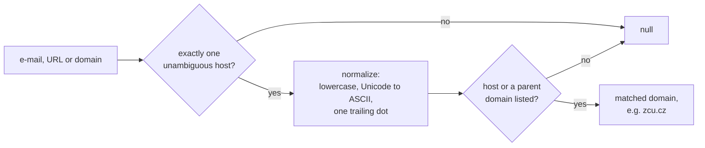

<p align="center">
  <picture>
    <source media="(prefers-color-scheme: dark)" srcset="https://raw.githubusercontent.com/danielsebesta/czsk-schools-domains/main/.github/assets/banner-en-dark.svg">
    
  </picture>
</p>

<p align="center">
  <a href="https://www.npmjs.com/package/czsk-schools-domains"></a>
  <a href="https://github.com/danielsebesta/czsk-schools-domains/actions/workflows/pr-check.yml"></a>
  
  
  
  <a href="https://github.com/danielsebesta/czsk-schools-domains/blob/main/LICENSE"></a>
  <a href="https://github.com/danielsebesta/czsk-schools-domains/blob/main/LICENSE-DATA.md"></a>
</p>

<p align="center">
  <b>English</b> · <a href="https://github.com/danielsebesta/czsk-schools-domains/blob/main/README.cs.md">Čeština</a>
</p>

Check whether an e-mail address, URL or domain belongs to a Czech or Slovak school, from primary schools to universities. **7,331** schools are in the discount list and **9,585** domains in total, each one checked against a register or the school's own website, and against DNS.

The data is institution metadata from public registers: no e-mail addresses, phone numbers or contact persons. Where the official name of a private school contains the name of its living founder or director, a neutral name (type of school and town) is used instead.

<p align="center">
  <a href="#quick-start">Quick start</a> ·
  <a href="#what-passes-and-what-doesnt">What passes</a> ·
  <a href="#a-match-is-not-proof-of-student-status">Security</a> ·
  <a href="#whats-in-the-data">Data</a> ·
  <a href="#same-rules-in-five-languages">Other languages</a> ·
  <a href="#tests">Tests</a> ·
  <a href="#contributing">Contributing</a>
</p>

## Quick start

```bash
npm install czsk-schools-domains
```

```ts
import { isSchoolDomain, matchSchoolDomain, extractDomain } from "czsk-schools-domains";

isSchoolDomain("student@student.zcu.cz");       // true  (matches zcu.cz)
isSchoolDomain("someone@gmail.com");            // false (freemail)
matchSchoolDomain("https://www.zcu.cz/studium"); // "zcu.cz"
extractDomain("Student <student@ZCU.cz>");      // "zcu.cz"
```

No dependencies, ESM and CommonJS, TypeScript types included, Node.js 18 or newer. The input can be an e-mail address (also `Name <user@school.cz>` and `mailto:`), a URL or a bare domain.

| Export | Returns |
|---|---|
| `isSchoolDomain(input)` | `true` when the host or one of its parent domains is in the discount list |
| `matchSchoolDomain(input)` | the matched list entry (`"zcu.cz"`), or `null` |
| `extractDomain(input)` | the normalized host (`"www.zcu.cz"`), or `null` when the input is ambiguous |
| `createChecker(list)` | `{ isSchool, match, size }` for any other list |
| `schoolDomains` | the discount list: frozen, sorted |

<details>
<summary><b>More examples</b></summary>

```ts
import { readFileSync } from "node:fs";
import { isSchoolDomain, matchSchoolDomain, createChecker } from "czsk-schools-domains";

// Case-insensitive; subdomains of a listed domain match too
isSchoolDomain("student@gapps.zcu.cz");         // true  (matches zcu.cz)
isSchoolDomain("123456@mail.muni.cz");          // true  (matches muni.cz)
isSchoolDomain("student@fiit.stuba.sk");        // true  (matches fiit.stuba.sk)
isSchoolDomain("student@st.uniba.sk");          // true  (matches uniba.sk)
isSchoolDomain("zak@student.gjp.cz");           // true  (matches student.gjp.cz)
isSchoolDomain("info@skola.hradekususice.cz");  // true  (matches skola.hradekususice.cz)

// Not schools
isSchoolDomain("someone@seznam.cz");            // false (freemail)
isSchoolDomain("info@hradekususice.cz");        // false (municipal portal; only skola.* is listed)
isSchoolDomain("info@18mskladno.cz");           // false (kindergarten; only in domains-all.json)
isSchoolDomain("x@neoverena-skola.edu.cz");     // false (unverified edu.cz subdomain)
isSchoolDomain("x@neoverena-skola.edu.sk");     // false (unverified edu.sk subdomain)

// Ambiguous input is refused
matchSchoolDomain("https://evil.example/?a=x@zcu.cz"); // null (an "@" in a path or query is not the host)
matchSchoolDomain("zcu.cz/@evil.example");      // null (the mail would go to evil.example)
matchSchoolDomain("a@evil.example, b@zcu.cz");  // null (several recipients)

// Any other list, e.g. domains-all.json (with kindergartens) from the GitHub Release.
// createChecker throws a TypeError on entries that are not valid domain names.
const all = createChecker(JSON.parse(readFileSync("domains-all.json", "utf8")));
all.isSchool("info@18mskladno.cz");             // true
```

</details>

## What passes and what doesn't



| Input | Host | Match | Result |
|---|---|---|---|
| `student@zcu.cz` | `zcu.cz` | `zcu.cz` | **school** |
| `Student <student@ZCU.cz>` | `zcu.cz` | `zcu.cz` | **school**: display name and case don't matter |
| `https://www.zcu.cz/studium` | `www.zcu.cz` | `zcu.cz` | **school**: subdomains match their listed parent |
| `ｓtudent@ｚcu.cz`, `x@zcu。cz` | `zcu.cz` | `zcu.cz` | **school**: fullwidth letters and dots are normalized |
| `someone@seznam.cz` | `seznam.cz` | `null` | not a school: free-mail provider |
| `info@18mskladno.cz` | `18mskladno.cz` | `null` | not a school: kindergarten, only in `domains-all.json` |
| `x@škola.cz` | `xn--kola-f6a.cz` | `null` | not a school: no listed domain has diacritics |
| `https://evil.example/?a=x@zcu.cz` | `evil.example` | `null` | not a school: the host is `evil.example` |
| `zcu.cz/@evil.example` | `null` | `null` | refused: the mail would go to `evil.example` |
| `a@evil.example, b@zcu.cz` | `null` | `null` | refused: several recipients |
| `a@evil.example@zcu.cz` | `null` | `null` | refused: more than one `@` |
| `@relay.example:x@zcu.cz` | `null` | `null` | refused: source route |
| `x@zcu\u200b.cz` | `null` | `null` | refused: invisible character (zero-width space) |
| `x@192.168.0.1` | `null` | `null` | refused: an IP address is not a domain |
| `student'--@zcu.cz` | `zcu.cz` | `zcu.cz` | **school**, but only the domain is checked: escape the input |
| `javascript://zcu.cz/%0aalert(1)` | `zcu.cz` | `zcu.cz` | **school**, but a match is not a safe link |

## A match is not proof of student status

> [!IMPORTANT]
> A match only says that the address points to a school's domain. **Confirm the mailbox**: send a one-time code to the exact address and require it back. Where possible, also ask for an ISIC card or a confirmation of study.

- Teachers, other staff, parents' accounts at some schools and sometimes graduates (e.g. `alumni.cvut.cz`) have addresses there too. Subdomains of a listed domain match as well, e.g. a university kindergarten under the university domain.
- Validate the address format first. The package refuses ambiguous input: several recipients, comments, quoted local parts, backslashes, more than one `@`, a `:` in an address (a source route such as `@relay.example:student@school.cz`), an `@` together with `/`, `?` or `#` (`school.cz/@evil.example` is an address at `evil.example`), and invisible or bidirectional formatting characters (zero-width space, right-to-left override).
- Only the domain is checked. The part before the `@` is passed through as typed, so escape or parameterize the input before it goes into SQL, HTML, e-mail headers or a shell command. A matching URL is not a safe link either.
- Most primary-school pupils are below the GDPR age of digital consent (15 in the Czech Republic, 16 in Slovakia). If you rely on consent, ask for the parents' consent, or use `level` in `domains-detailed.json` to leave primary schools out.
- Domains change owners. The list is re-checked, but a domain that expired yesterday can still be in it: keep the one-time-code step.

## What's in the data

| File | Contents | Domains |
|---|---|---:|
| [`domains.json`](https://github.com/danielsebesta/czsk-schools-domains/blob/main/data/domains.json), [`domains.txt`](https://github.com/danielsebesta/czsk-schools-domains/blob/main/data/domains.txt) | The discount list: schools from primary to university, art and language schools, leisure-time centres | 7,331 |
| [`domains-all.json`](https://github.com/danielsebesta/czsk-schools-domains/blob/main/data/domains-all.json) | The discount list plus kindergartens, nurseries, school facilities and staff-only university units | 9,585 |
| [`domains-detailed.json`](https://github.com/danielsebesta/czsk-schools-domains/blob/main/data/domains-detailed.json) | Every domain with its school's name, address, IČO, type and DNS facts | 9,585 |
| [`custom-domains.json`](https://github.com/danielsebesta/czsk-schools-domains/blob/main/data/custom-domains.json) | Community additions | |
| [`blocklist.json`](https://github.com/danielsebesta/czsk-schools-domains/blob/main/data/blocklist.json) | Domains that must never be listed: free-mail, ISPs, hosting, municipalities | 267 |

The four lists are also attached to every [GitHub Release](https://github.com/danielsebesta/czsk-schools-domains/releases). School facilities are canteens, dormitories, counselling centres, children's homes and youth-care institutes; staff-only university units are rectorates and research centres.

<p align="center">
  <picture>
    <source media="(prefers-color-scheme: dark)" srcset="https://raw.githubusercontent.com/danielsebesta/czsk-schools-domains/main/.github/assets/chart-types-en-dark.svg">
    
  </picture>
</p>

| Type of school | `kind` | CZ | SK | Total |
|---|---|---:|---:|---:|
| Primary schools (ZŠ) | `zs` | 3,521 | 619 | 4,140 |
| Secondary schools (SŠ, SOŠ, SOU) | `sos` | 727 | 272 | 999 |
| Art schools (ZUŠ) | `zus` | 430 | 163 | 593 |
| Grammar schools (gymnázium) | `gymnazium` | 389 | 165 | 554 |
| Special schools | `special` | 269 | 74 | 343 |
| Leisure-time centres (DDM, SVČ, CVČ) | `ddm` | 214 | 47 | 261 |
| Higher vocational schools (VOŠ) | `vos` | 167 | 0 | 167 |
| Universities | `vs` | 78 | 42 | 120 |
| Faculties | `fakulta` | 57 | 42 | 99 |
| Language schools | `jazykova` | 17 | 11 | 28 |
| Conservatories | `konzervator` | 19 | 8 | 27 |
| **Discount list** | | **5,888** | **1,443** | **7,331** |

6,893 of the 7,331 domains (94 %) receive e-mail. The others are school websites without their own mail; they stay so that URLs match.

### Record format

Every record in `domains-detailed.json` looks like this:

```json
{
  "domain": "zcu.cz",
  "name": "Západočeská univerzita v Plzni",
  "address": "Univerzitní 2732/8",
  "city": "Plzeň",
  "zip": "30100",
  "ico": "49777513",
  "id": null,
  "country": "CZ",
  "kind": "vs",
  "level": "he",
  "confidence": 100,
  "verified": true,
  "in_discount": true,
  "mx": true,
  "sources": ["hipo-university-domains", "jetbrains-swot", "school-email-own-domain", "school-website", "wikidata-website"]
}
```

| Field | Format |
|---|---|
| `name` | The official name from the school registry (CZ RSSZ, SK RIS), otherwise the legal name from ARES / RPO. Legal forms are written one way (`, s.r.o.`, `, spol. s r.o.`, `, o.p.s.`, `, z.ú.`, `, a.s.`, `, n.o.`, `, příspěvková organizace`); spaced dashes are always ` - `. |
| `address` | `Street 123/4` (land-registry number / house number), `Street 4` when there is one number, or the part of the municipality when there is no street (`Hrhov 46`). |
| `city` | The municipality as the registry writes it (`Praha`, `Frýdek-Místek`). Districts of Bratislava and Košice are written as `Bratislava` / `Košice`. |
| `zip` | 5 digits without a space (`11000`). |
| `ico` | The 8-digit IČO. `null` for Slovak schools without an IČO of their own (e.g. kindergartens run directly by a municipality) and for a few institutions without a confirmed IČO. |
| `id` | CZ `RED_IZO` or SK `EDUID`. |
| `country` | `CZ` or `SK`. |
| `kind`, `level` | The type of school (table above, plus `ms`, `jesle`, `other_edu` in `domains-all.json`) and its level: `primary`, `secondary`, `he`, `preschool` or `other`. |
| `confidence` | 0–100: how sure the classification of the school is. |
| `verified` | `true` when the maintainers confirmed the domain against a register or the school's own website or e-mail contact. A new community entry starts as `false` with `confidence` 50. |
| `in_discount` | `true` when the domain is in the discount list. |
| `mx` | `true` when the domain had an MX record with a resolvable mail server at the DNS check on 2026-11-25. `false`: no MX record, a null MX (`0 .`) or an MX pointing to a server that does not exist. Where the registry gives the school a different e-mail domain, that domain is listed as well. |
| `sources` | Where the domain was found and confirmed. |

- Addresses come from the CZ school registry by `RED_IZO`, then the ARES registered seat by IČO; in Slovakia from the school registry by `EDUID` / IČO, then the RPO seat. Faculties and other parts of a university share the university's IČO and seat address.
- `address`, `city` and `zip` are `null` for the 12 entries without a confirmed registry record. For 3 schools run by a natural person only `city` is given.
- `domains-detailed.json` is curated: it was built from the registers with private tooling and manual review and cannot be regenerated from this repository alone. Changes go through `custom-domains.json` / `blocklist.json`, or a reviewed PR that edits the record.

## Same rules in five languages

| Language | Code | Unicode domains | Batch mode |
|---|---|---|---|
| TypeScript / JavaScript | [npm package](https://www.npmjs.com/package/czsk-schools-domains) | yes | |
| Python | [`examples/python`](https://github.com/danielsebesta/czsk-schools-domains/blob/main/examples/python/check.py) | yes | `--json` |
| PHP | [`examples/php`](https://github.com/danielsebesta/czsk-schools-domains/blob/main/examples/php/check.php) | with `ext-intl` | `--json` |
| Go | [`examples/go`](https://github.com/danielsebesta/czsk-schools-domains/tree/main/examples/go) | ASCII only | `-json` |
| Shell | [`examples/shell`](https://github.com/danielsebesta/czsk-schools-domains/blob/main/examples/shell/check.sh) | no: plain addresses, exact match | |

```bash
python examples/python/check.py student@zcu.cz
php examples/php/check.php student@zcu.cz
bash examples/shell/check.sh student@zcu.cz
cd examples/go && go run . student@zcu.cz
```

The examples follow the same input rules as the package. Batch mode reads a JSON array of inputs on stdin and prints a JSON array of `[host, match]`; the tests use it to compare every answer with the package.

## Tests

| Suite | What it checks |
|---|---|
| Corpus | Over 300 inputs that people type or attackers try, in 11 groups: typos, copy-paste spaces, Unicode and fullwidth characters, homoglyphs, IP addresses, invisible and bidi characters, SQL / HTML / header / shell injection, bypass attempts |
| Fuzzing | 30,000 generated inputs, checked against the WHATWG URL parser and an e-mail address oracle |
| Mixing | A listed domain mixed with an attacker's domain and separators matches only when the mail really goes to the school |
| ReDoS | 2 KB adversarial inputs finish in milliseconds |
| Cross-language | The same inputs plus 6,000 generated ones go through the Python, PHP, Go and shell examples; every answer must match the package |
| API | Values that are not strings, detached functions, `createChecker` edge cases |
| Data | The published list is sorted, normalized and free of blocklisted, free-mail and public e-mail provider domains |
| README | Every example in this README and in the Czech one is executed |

Run `npm test` in `packages/ts` (Node.js 22.18 or newer). A runtime that is not installed is skipped unless `REQUIRE_EXAMPLE_RUNTIMES=1`, as in CI.

## Automation

| Workflow | Runs on | Does |
|---|---|---|
| [PR check](https://github.com/danielsebesta/czsk-schools-domains/blob/main/.github/workflows/pr-check.yml) | pull requests, pushes to `main` | Validates the data with the scripts from the base branch, so a PR cannot weaken its own checks. A second job builds the package and runs all tests. |
| [DNS audit](https://github.com/danielsebesta/czsk-schools-domains/blob/main/.github/workflows/dns-audit.yml) | monthly | Opens or updates an issue that lists domains without active DNS or MX records. |
| [Release](https://github.com/danielsebesta/czsk-schools-domains/blob/main/.github/workflows/release.yml) | `vX.Y.Z` tags | Publishes to npm with provenance after a maintainer's approval and attaches the lists to the GitHub Release. |

What the PR check verifies in detail is listed in [CONTRIBUTING.md](https://github.com/danielsebesta/czsk-schools-domains/blob/main/CONTRIBUTING.md#what-the-pr-check-verifies).

## Contributing

Missing school, dead domain or wrong data? See [CONTRIBUTING.md](https://github.com/danielsebesta/czsk-schools-domains/blob/main/CONTRIBUTING.md). Removing blocklist entries, changing the `kind` of a record, moving a record into the discount list or adding more than 200 domains needs a maintainer's review.

## Corrections and privacy

- A school can ask for a correction or for its domain to be removed through the [Correction or removal](https://github.com/danielsebesta/czsk-schools-domains/issues/new?template=correction.yml) issue form. Please do not post personal data in issues. Requests are answered within one month.
- Published are the domains of schools and the institutions' own metadata from public registers (name, address of the seat, IČO, registry id, type of school), plus technical DNS facts. No e-mail addresses, phone numbers or names of contact persons.
- Purpose and legal basis: helping services recognise school e-mail domains (legitimate interest, Art. 6(1)(f) GDPR). Where a record relates to a natural person (a school run by a sole trader), only the town is given; you can object or ask for a correction or removal through the issue form.

## Sources and licence

| Source | Used for | Licence |
|---|---|---|
| CZ school registry (RSSZ directory) | schools, official names, addresses, `RED_IZO` | public register |
| SK school registry (RIS, eduZoznam) | schools, official names, addresses, `EDUID` | public register |
| ARES (CZ), RPO (SK) | legal names and registered seats by IČO | public registers |
| MŠMT registers of universities (CZ) | universities | public register |
| School websites and their contact pages | domains and their confirmation | |
| [Wikidata](https://www.wikidata.org/) | school websites | CC0 |
| [JetBrains/swot](https://github.com/JetBrains/swot) | academic domains | MIT |
| [Hipo/university-domains-list](https://github.com/Hipo/university-domains-list) | university domains | MIT |

RPO has been run by the Ministry of the Interior of the Slovak Republic since June 2026, previously by the Statistical Office. Language models helped classify the type of school from home pages; disputed cases were settled against the registers or by hand.

- **Data** (`data/` and the list inside the npm package): [CC BY 4.0](https://github.com/danielsebesta/czsk-schools-domains/blob/main/LICENSE-DATA.md). Source attributions and third-party licence texts are in [THIRD_PARTY_NOTICES.md](https://github.com/danielsebesta/czsk-schools-domains/blob/main/THIRD_PARTY_NOTICES.md).
- **Code** (scripts, examples, `packages/ts`): [MIT](https://github.com/danielsebesta/czsk-schools-domains/blob/main/LICENSE).
